# 📊 Autonomous Due Diligence Analyst — Local LLM, LangGraph & pgvector

<div align="center">

### Privacy-Preserving Multi-Agent Financial & Legal Due Diligence Engine

[](https://www.python.org/)
[-792EE5?style=flat-square)](#-privacy-preserving--local-first-inference)
[-success?style=flat-square)](#-privacy-preserving--local-first-inference)
[](https://github.com/langchain-ai/langgraph)
[](https://github.com/pgvector/pgvector)
[](#-stateless-distributed-architecture)
[](#-deterministic-financial-engine--the-13-metrics)
[](https://eur-lex.europa.eu/)

[Executive Summary](#-executive-summary) • [System Architecture](#-end-to-end-system-architecture) • [Privacy & Local AI](#-privacy-preserving--local-first-inference) • [Live Benchmark](#-proven-audit-benchmark-sap-se-case-study) • [Agent Topology](#-agent-topology--cognitive-state-machine) • [Financial Engine](#-deterministic-financial-engine--the-13-metrics) • [Engineering Architecture](#-engineering--systems-architecture)

</div>

---

## 📌 Executive Summary

Manual Due Diligence across corporate filings (10-K, 20-F, annual reports), real-time capital market feeds, and regulatory enforcement registries represents an acute operational bottleneck for Private Equity, M&A boutiques, and family offices. Standard "naive RAG" tools routinely hallucinate accounting multiples, fail to reconcile conflicting management narratives, and expose institutions to catastrophic liability by sending non-public deal documents to external cloud APIs.

The **Autonomous Due Diligence Analyst** is an institutional-grade, multi-agent research and decision-support platform architected by **[landmansIT](https://github.com/elvijslan-stack)**. Engineered with a **Strictly Local LLM Inference Core**, **LangGraph**, **pgvector**, and an **air-gapped gVisor/MicroVM execution sandbox**, it transforms unorganized documents and live SEC/market feeds into **audit-ready, 6-page Investment Memos in under 90 seconds**.

### Core Technical Differentiators:
- **100% Local Inference & NDA Compliance:** Core reasoning runs on local open-weight models (via Ollama: Qwen 2.5/3, Llama 3). **Confidential data room documents, internal filings, and financial models never leave your private infrastructure.** External egress is restricted strictly to anonymized public registry checks and real-time market data refreshes.
- **Zero-Hallucination Numerics:** LLMs are strictly forbidden from performing mental math. Calculations (13+ hard metrics including YoY Growth, EV/EBITDA, FCF, Net Debt, DSO) are computed deterministically via verified AST formulas or inside network-isolated MicroVM containers.
- **Cross-Source Contradiction Arbitrage:** Automatically reconciles corporate disclosures against regulatory enforcements (BaFin, SEC FCPA, US Supreme Court, EU Antitrust) using relative tolerance thresholds ($\Delta \ge 5\%$) and credibility weighting.
- **Automated Relative Peer Valuation:** Compares target multiples and margins dynamically against industry rivals (e.g., SAP vs. Oracle, Salesforce, Microsoft).
- **Cryptographic Provenance:** Every claim, number, and finding in the final ReportLab PDF is linked to a verbatim citation, page number, and publication timestamp.

---

## 🔒 Privacy-Preserving & Local-First Inference

In high-stakes M&A and Private Equity, sending non-public corporate files to external proprietary APIs (OpenAI, Anthropic) breaches non-disclosure agreements (NDAs) and banking-grade security mandates.

The system enforces a **Bifurcated Data Flow**:

```text
  [ Confidential Corporate Files ] ──► Ingestion & Parsing (Local Storage)
  [ Data Room / Internal 10-K    ] ──► pgvector Embeddings (Local pgvector)
  [ Accounting Notes & Bilanzen  ] ──► Local LLM Reasoning (Ollama / Qwen / Llama)
                                                 │
                           ZERO DATA EXFILTRATION│ (Air-Gapped Core)
                                                 ▼
             ────────────────── Security Boundary ──────────────────
                                                 │
                               Controlled Egress │ (Generic Discovery Queries Only)
                                                 ▼
                              [ Public Search / Reg APIs ] (Tavily, SEC, Finnhub)
                              [ Live Stock Quotes & News ] (Peer Multiples & Delta)
```

1. **Local Core Reasoning:** Synthesis, claim extraction, contradiction detection, and risk evaluation execute **exclusively on local GPUs/CPUs**.
2. **Selective Public Egress:** Only generic, non-confidential search terms (e.g. *"SAP antitrust fine BaFin"*) and stock ticker requests are routed externally to verify market consistency and refresh live prices.

---

## 🖥 Modern Analyst Dashboard

<div align="center">
  
  <p><em>Production UI with Multi-File Drag & Drop (up to 20 files / 50MB), automated SEC EDGAR/Web ingestion, and real-time Server-Sent Events (SSE) telemetry.</em></p>
</div>

---

## ⚡ Proven Audit Benchmark: SAP SE Case Study

In production benchmarks, the engine performed an end-to-end due diligence audit on **SAP SE** (evaluating antitrust exposure, FCPA filings, and valuation relative to enterprise software peers):

```text
Audit Telemetry: SAP SE Execution Log (100% Local LLM + Controlled Web Verification)
──────────────────────────────────────────────────────────────────────────────
[19:44:09] started run        Target: 'SAP SE' | Question: 'Sollten wir investieren?'
[19:45:15] step plan          Decomposed into 5 prioritized research sub-questions
[19:45:16] step signals       Extracted 7 operational, legal & financial stress markers
[19:45:19] step web_search    Executed 2 targeted queries -> 10 new external evidences
[19:45:19] step claims        Extracted 112 verifiable assertions & table cells
[19:45:19] step contradiction Arbitrage completed -> 0 unresolved disputes
[19:45:20] step calculations  Computed 13 deterministic accounting ratios via sandbox
[19:45:20] step legal_finds   Flagged 4 active proceedings (BaFin, SEC FCPA, US Court)
[19:45:20] step risk_matrix   Synthesized Risk Score: 0.619 | Confidence: 92.0%
[19:45:20] step memo          Investment Recommendation: 'HALTEN' (Score -1)
[19:45:20] completed run      6-Page Publication-Grade PDF Memo Generated in 71.4s
──────────────────────────────────────────────────────────────────────────────
```

**Result:** A decision-ready **6-page PDF Investment Memo** compiled in **71 seconds**, identifying a €1.75M BaFin penalty, active US antitrust litigation, and an elevated P/E ratio of 36.8x, yielding an objective **"HALTEN" (Score -1)** rating.

---

## 🏛 End-to-End System Architecture

The pipeline processes targets through an asynchronous, budget-controlled cognitive loop, coupling layout-aware ingestion, dense/lexical retrieval, deterministic sandbox execution, and human oversight:

```mermaid
flowchart TD
    Start(["Target Ingestion: Company & Hypothesis"])
    Parser["Multi-Source Ingestion: PDF/MD/TXT Upload + SEC EDGAR XBRL"]
    Planner["Planner Agent: Local LLM Decomposition"]

    Start --> Parser
    Parser --> Planner

    subgraph RAGSubsystem ["⚡ Local Bimodal RAG & Signal Extraction"]
        direction TB
        HybridRAG["Hybrid Retrieval: pgvector Dense + Native BM25"]
        Reranker["Cross-Encoder: BAAI/bge-reranker-base"]
        SigDetector["Signal Detector: Local Stress & Discrepancy Scanners"]

        HybridRAG --> Reranker
        Reranker --> SigDetector
    end

    Planner --> HybridRAG

    subgraph DiscoveryLoop ["🌐 Controlled External Verification & Live Refresh"]
        direction TB
        QueryRewriter["Query Rewriter: Anonymized Verification Queries"]
        WebAgent["Web & Registry Agent: BaFin, EUR-Lex, Finnhub & Tavily"]
        PromptGuard["Prompt Guard: Anti-Injection & Exfiltration Sanitizer"]

        QueryRewriter --> WebAgent
        WebAgent --> PromptGuard
    end

    SigDetector -->|"Delta Verification Needed"| QueryRewriter

    subgraph VerificationEngine ["🛡️ Deterministic Verification Engine"]
        direction TB
        ClaimExtractor["Claim Extractor: Tables, Numbers & Statements"]
        Contradiction["Contradiction Verifier: Credibility & Tolerance Arbitrage"]
        FinanceEngine["Deterministic Finance Engine: 13+ Hard Metrics"]
        LegalRiskLinker["Legal Risk Linker: Severity to Score Mapping"]

        ClaimExtractor --> Contradiction
        Contradiction --> FinanceEngine
        FinanceEngine --> LegalRiskLinker
    end

    SigDetector -->|"Local Internal Evidence"| ClaimExtractor
    PromptGuard -->|"Sanitized External Evidence"| ClaimExtractor

    subgraph SynthesisPhase ["📋 Governance, Benchmarking & Memo Synthesis"]
        direction TB
        PeerEngine["Peer Benchmarking: Automated Competitor Multiples"]
        RiskScorer["Risk Matrix Synthesizer: Multi-Factor Scoring"]
        HITLGate{"HITL Approval Gate: Human Oversight"}
        MemoWriter["Report Writer: Local Memo Synthesis"]
        ExportEngine["Export Engine: ReportLab 6-Page PDF / Markdown / JSON"]
        Terminate(["Audit Terminated"])

        PeerEngine --> RiskScorer
        RiskScorer --> HITLGate
        HITLGate -->|"Approved"| MemoWriter
        HITLGate -->|"Rejected"| Terminate
        MemoWriter --> ExportEngine
    end

    LegalRiskLinker --> PeerEngine
```



---

## 🤖 Agent Topology & Cognitive State Machine

The orchestration layer models the audit workflow as an explicit state machine over `DDState`. Agents operate strictly within bounded operational boundaries:

| Agent | Responsibility | Analytical Output |
| :--- | :--- | :--- |
| **`PlannerAgent`** | Deconstructs investment hypotheses into prioritized, verifiable sub-questions. | `ResearchPlan` (Sub-queries + rationales) |
| **`SignalDetectorAgent`** | Scans semantic chunks for stress indicators (supply chains, covenant breaches, ESG). | `Signal[]` (Categorized by severity) |
| **`QueryRewriterAgent`** | Transforms internal signal alerts into external discovery queries for real-time verification. | `FollowUpQuery[]` (Domain-targeted) |
| **`WebSearchAgent`** | Retrieves real-time regulatory filings and news; filtered via `PromptGuard`. | `Evidence[]` (External provenance) |
| **`ClaimExtractorAgent`** | Isolates numerical claims and factual assertions; preserves table topologies without fragmenting. | `Claim[]` (Values, units, bounding contexts) |
| **`ContradictionAgent`** | Detects metric discrepancies across disparate sources; applies credibility rank resolution. | `Contradiction[]` (Severity & auto-resolution) |
| **`FinanceCalcAgent`** | Executes math through native deterministic libraries or sandboxed subprocesses. | `Calculation[]` (Formula + exact audit trail) |
| **`RegulatoryAgent`** | Mines EUR-Lex, BaFin, and EU sanctions lists for active proceedings and obligations. | `LegalFinding[]` (Jurisdiction-bound) |
| **`RiskScorerAgent`** | Synthesizes multidimensional risk matrices with dynamic penalty scoring. | `RiskMatrix` (Overall score + confidence index) |
| **`ReportWriterAgent`** | Drafts comprehensive Investment Memos with strict quote attribution and gap disclosures. | `InvestmentMemo` (Cited decision baseline) |

---

## 🧮 Deterministic Financial Engine: The 13 Metrics

The system rejects stochastic LLM calculations in favor of verified formulas executed via standard libraries or isolated MicroVM sandboxes. Every metric preserves its formula, inputs, and physical unit:

| Metric Identifier | Exact Mathematical Formula | Execution Result (SAP SE Audit) | Unit Category |
| :--- | :--- | :--- | :--- |
| **`yoy_growth`** | `(revenue_current - revenue_prior) / \|revenue_prior\|` | `7.7 %` | `ratio` |
| **`gross_margin`** | `(revenue - cogs) / revenue` | `72.9 %` | `ratio` |
| **`operating_margin`** | `operating_income / revenue` | `26.1 %` | `ratio` |
| **`ebitda_margin`** | `ebitda / revenue` | `28.0 %` | `ratio` |
| **`free_cash_flow`** | `operating_cash_flow - \|capex\|` | `8.42 Mrd. €` | `currency` |
| **`net_debt`** | `total_debt - cash_and_equivalents` | `-2.07 Mrd. €` *(Net Cash)* | `currency` |
| **`net_debt_to_ebitda`** | `(total_debt - cash) / ebitda` | `-0.20x` | `multiple` |
| **`days_sales_outstanding`**| `(accounts_receivable / revenue) * 365` | `66 Tage` | `days` |
| **`current_ratio`** | `current_assets / current_liabilities` | `1.16x` | `multiple` |
| **`market_cap`** | `stock_price * shares_outstanding` | `275.65 Mrd. €` | `currency` |
| **`pe_ratio`** | `stock_price / eps` | `36.77x` | `multiple` |
| **`ev`** | `market_cap + net_debt` | `273.58 Mrd. €` | `currency` |
| **`ev_to_ebitda`** | `ev / ebitda` | `26.55x` | `multiple` |

---

## 📈 Automated Peer Benchmarking

A standalone target analysis is incomplete without market context. The engine automatically pulls dynamic peer metrics via Finnhub and SEC filings to generate a relative valuation matrix:

```text
Peer Group Analysis: Enterprise Application Software
─────────────────────────────────────────────────────────────────────────────
Company             Ticker    P/E (KGV)    EV/EBITDA    Gross Margin    YoY Growth
─────────────────────────────────────────────────────────────────────────────
SAP SE (Target)     SAP         36.77x       26.55x        72.9 %         7.7 %
Oracle              ORCL        20.79x       20.05x        64.0 %        21.6 %
Salesforce          CRM         20.48x       24.37x        77.3 %        11.2 %
Microsoft           MSFT        29.76x       21.00x        67.9 %        17.8 %
─────────────────────────────────────────────────────────────────────────────
Valuation Insight: SAP SE trades at a 78% premium on P/E against Oracle despite 
slower top-line growth, justifying a valuation penalty in the final recommendation.
```

---

## 🎯 Multi-Factor Recommendation Engine

The recommendation logic balances quantitative valuation multiples against legal liabilities and cash flow strength:

$$\text{Recommendation Score} = \text{Score}_{\text{Valuation}} + \text{Score}_{\text{Profitability}} - \text{Penalty}_{\text{Risk}}$$

- **BUY (Score $\ge +2$):** Undervalued multiples, strong FCF, clean regulatory record.
- **HOLD / HALTEN (Score $-1$ to $+1$):** Elevated multiples offset by strong profitability, or mixed legal risk (e.g., SAP SE: P/E 36.8x [-1], EV/EBITDA 26.5x [-1], strong FCF 8.42B [+1], strong operating margin [+1], legal overhang [-1] $\rightarrow$ **Score -1: HALTEN**).
- **SELL (Score $\le -2$):** Critical risk profile, covenant pressure, or negative cash flow.

---

## ⚖️ Legal & Regulatory Enforcement Engine

The analyst actively mines court registries, BaFin sanction records, and SEC enforcement dockets. Each finding is assigned a quantified risk impact score:

$$\text{Risk Score} = \text{Probability } (P) \times \text{Impact } (I)$$

```text
Identified Legal Overhang: SAP SE Audit
──────────────────────────────────────────────────────────────────────────────
Finding                                  Jurisdiction  Severity    P      I   Score
──────────────────────────────────────────────────────────────────────────────
EU Antitrust Proceeding (Cloud Lock-in)  EU            Critical  0.85   0.90   0.77
US Supreme Court Antitrust (Teradata)    US            Critical  0.85   0.90   0.77
BaFin Sanction (€1.75M Securities Fine)  DE            Medium    0.40   0.45   0.18
SEC FCPA Bribery Violations              US            Medium    0.40   0.45   0.18
──────────────────────────────────────────────────────────────────────────────
Overall Risk Profile: 0.619 (Erhöht) | Overall Confidence: 92.0%
```

---

## 🛡️ Enterprise Security & Sandboxing

Operating on untrusted web inputs and executing generated verification code mandates defense-in-depth:

- **gVisor / MicroVM Subprocess Isolation (`sandbox/interpreter.py`):** Code evaluation runs under `python -I -S -c` (isolated runtime, no user environment, empty `PATH`/`PYTHONPATH`). All network socket calls (`socket`, `ssl`) are monkey-patched to throw immediate exceptions, eliminating data exfiltration risks.
- **PromptGuard Ingestion Filter (`security/prompt_guard.py`):** Neutralizes instruction injections (`ignore previous instructions`, `system:`) and strips invisible Unicode control tags (`U+E0000–U+E007F`) from external web pages.
- **Stateless Redis Pub/Sub Bus:** Fully decouples execution workers from the FastAPI SSE streaming layer, enabling horizontal pod autoscaling (HPA) across Kubernetes nodes without sticky sessions.
- **Tamper-Evident Audit Trails:** State transitions, authentication decisions, and generated calculations are written to append-only JSONL files or dedicated PostgreSQL audit tables (`dd_audit_events`).

---

## 🚀 Quickstart & Production Setup

### 1. Installation

```bash
# Clone the repository
git clone https://github.com/elvijslan-stack/due-diligence-analyst.git
cd due-diligence-analyst

# Initialize virtual environment
python -m venv .venv
source .venv/bin/activate  # Windows: .venv\Scripts\activate

# Install all enterprise dependencies
pip install -e ".[all]"

# Configure runtime environment
cp .env.example .env
```

### 2. Local Model Setup (Ollama)

Ensure local inference models are ready:

```bash
# Pull local reasoning & embedding models
ollama pull qwen2.5:14b
ollama pull nomic-embed-text
```

### 3. CLI Execution

Run an autonomous audit on a target company using local files or SEC auto-fetch:

```bash
# Audit a target company against local filings
dd-analyst analyze \
  --company "SAP SE" \
  --corpus ./corpus/sap_2024 \
  --question "Evaluate antitrust liabilities, cloud margins, and peer valuation."

# Export directly to structured JSON
dd-analyst analyze --company "SAP SE" --corpus ./corpus --json
```

### 4. API & WebUI

Start the asynchronous FastAPI backend with embedded Server-Sent Events (SSE) and dark-mode browser interface:

```bash
dd-analyst serve --host 0.0.0.0 --port 8000
```
- **Web UI:** Navigate to `http://localhost:8000/`
- **Swagger Documentation:** Available at `http://localhost:8000/docs`
- **Prometheus Metrics:** Scraped at `http://localhost:8000/prometheus`

---

## 🧑‍💻 Engineering & Systems Architecture

Architected by **Elvijs Landmans ([landmansIT](https://github.com/elvijslan-stack))**.

- **Sovereign Local-First AI:** Air-gaps confidential enterprise filings within local on-premise infrastructure via self-hosted LLM runtimes, utilizing external endpoints solely for non-confidential delta-verification and market pricing.
- **Neuro-Symbolic Due Diligence:** Enforces an uncompromised separation between probabilistic LLM reasoning (hypothesis decomposition, narrative extraction) and deterministic symbolic compute (XBRL parsing, formula libraries, discrepancy arbitrage).
- **Cyclic State Graph with Budgetary Gating:** Encapsulates analysis in LangGraph with memory checkpointing, bounded discovery loops, and strict cost limits to eliminate infinite recursion in high-latency discovery workflows.
- **Zero-Trust MicroVM Isolation:** Mitigates host-kernel escape risks by running unverified code in air-gapped gVisor/subprocess environments stripped of networking privileges, file paths, and environment access.
- **Stateless Cloud-Native Scale:** Eliminates single-point-of-failure bottlenecks via a distributed Redis Pub/Sub event bus, decoupling compute-heavy agent runners from the SSE streaming web tier.
- **Authoritative Provenance Graphs:** Enforces strict citation verification where every claim is validated against document IDs, page offsets, and publication dates—retaining an auditable link between the final investment memo and source filings.

---

## ⚖️ Legal & Financial Disclaimer

> **CRITICAL NOTICE:** This platform is an automated decision-support research aggregator designed for corporate finance and legal analysts. **It does NOT offer financial, investment, accounting, or legal advice.** All synthesized investment memos, risk matrices, peer comparisons, and calculated financial ratios must be independently reviewed and verified by qualified professionals prior to capital allocation or contractual commitment.
